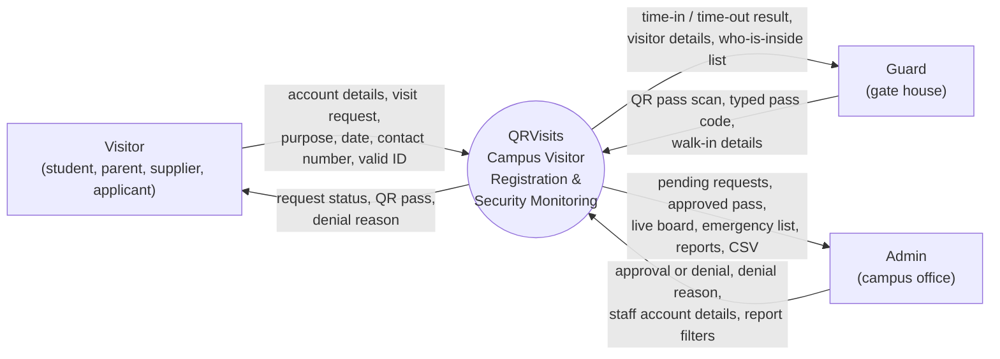
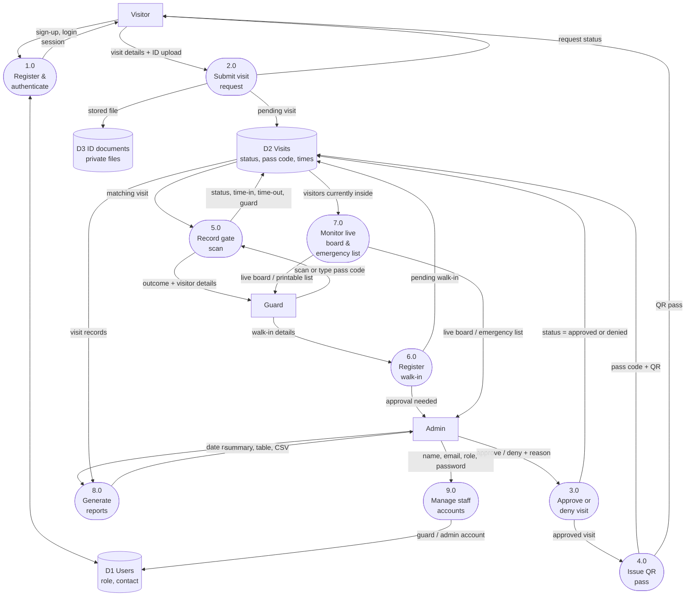
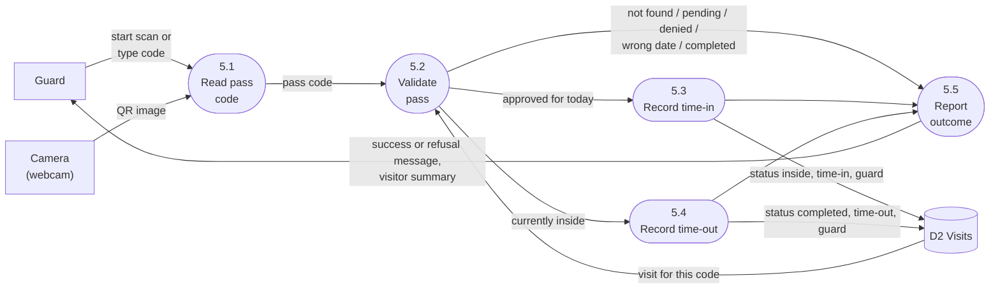

# QRVisits — Context and Data Flow Diagrams

> **Interactive version:** open **`/context/erd`** in the running app for the
> ERD, database structure tables and a print button.

Mermaid diagrams for the capstone documentation. They render automatically on
GitHub, GitLab, and VS Code with a Mermaid preview extension.

- **Level 0** — Context diagram: who talks to the system.
- **Level 1** — Data flow diagram: the main processes and data stores.
- **Level 2** — Gate scanning detail (the security-critical process).

Legend: rectangle = external entity, rounded box = process, cylinder = data
store, arrow = data flow.

---

## Level 0 — Context diagram

### External entities

| Entity | What they provide | What they receive |
| --- | --- | --- |
| Visitor | Account details, visit request (purpose, host, date, contact, valid ID) | Request status, QR pass, denial reason |
| Guard | QR scan / typed pass code, walk-in registration | Check-in/out outcome, visitor details, live board |
| Admin | Approve/deny decisions, staff account details, report filters | Approval queue, live board, emergency list, reports, CSV |

### System boundary

Inside QRVisits: accounts and roles, visit records, QR pass generation, gate
scanning, live monitoring, reports, and private ID storage.

Outside QRVisits (version 1): SMS/email providers, offline gate operation,
multi-campus/multi-gate support, and identity-document verification services.

---

## Level 1 — Data flow diagram

### Processes

| No. | Process | Main input | Main output |
| --- | --- | --- | --- |
| 1.0 | Register and authenticate | Account details, credentials | Session, user record |
| 2.0 | Submit visit request | Visitor details, visit date, ID file | Pending visit, stored ID |
| 3.0 | Approve or deny visit | Admin decision, reason | Updated visit status |
| 4.0 | Issue QR pass | Approved visit | Pass code and QR image |
| 5.0 | Record gate scan | Scanned/typed code | Time-in or time-out, outcome message |
| 6.0 | Register walk-in | Guard-entered visitor details | Pending walk-in visit |
| 7.0 | Monitor live board and emergency list | Visits with status `inside` | Live list, printable list |
| 8.0 | Generate reports | Date range | Totals, visit table, CSV |
| 9.0 | Manage staff accounts | Admin-entered account details | Guard/admin user records |

### Data stores

| Store | Contents | Who can read it |
| --- | --- | --- |
| D1 Users | Name, email, password hash, role (`visitor`/`guard`/`admin`), contact number | The user themselves; admins see staff accounts |
| D2 Visits | Visitor name/contact, purpose, host, visit date, status, pass code, denial reason, walk-in flag, approval and scan audit fields | Owner (own visits); guards and admins (all visits) |
| D3 ID documents | Uploaded JPG/PNG/PDF files on the private disk | Owner of the visit; guards and admins |

---

## Level 2 — Gate scanning (process 5.0)

### Validation outcomes shown to the guard

| Condition | Result |
| --- | --- |
| Code does not exist | "Pass not found" |
| Request still pending | "Not approved yet" |
| Request denied | "Visit was denied" |
| Pass used on another date | "Not valid today" |
| Visit already completed | "Already completed" |
| First valid scan of the day | Time-in recorded, visitor appears on the live board |
| Second valid scan | Time-out recorded, visitor leaves the live board |

---

## Notes for the documentation chapter

- A QR pass encodes only the short pass code; no personal data is in the QR.
- Passes become valid only after admin approval and only on the visit date.
- ID documents never sit in the public web folder and are served through an
  authorised route.
- Version 1 assumes a stable internet connection at the gate; there is no
  offline queue.
