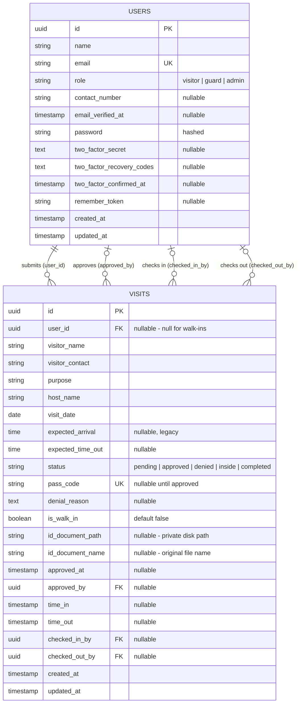
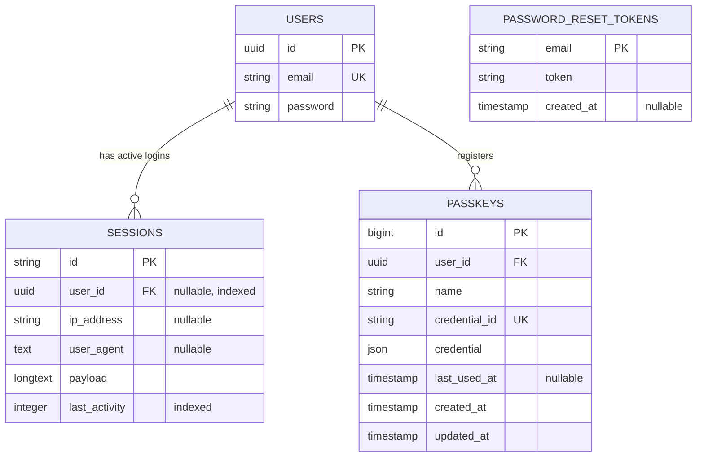
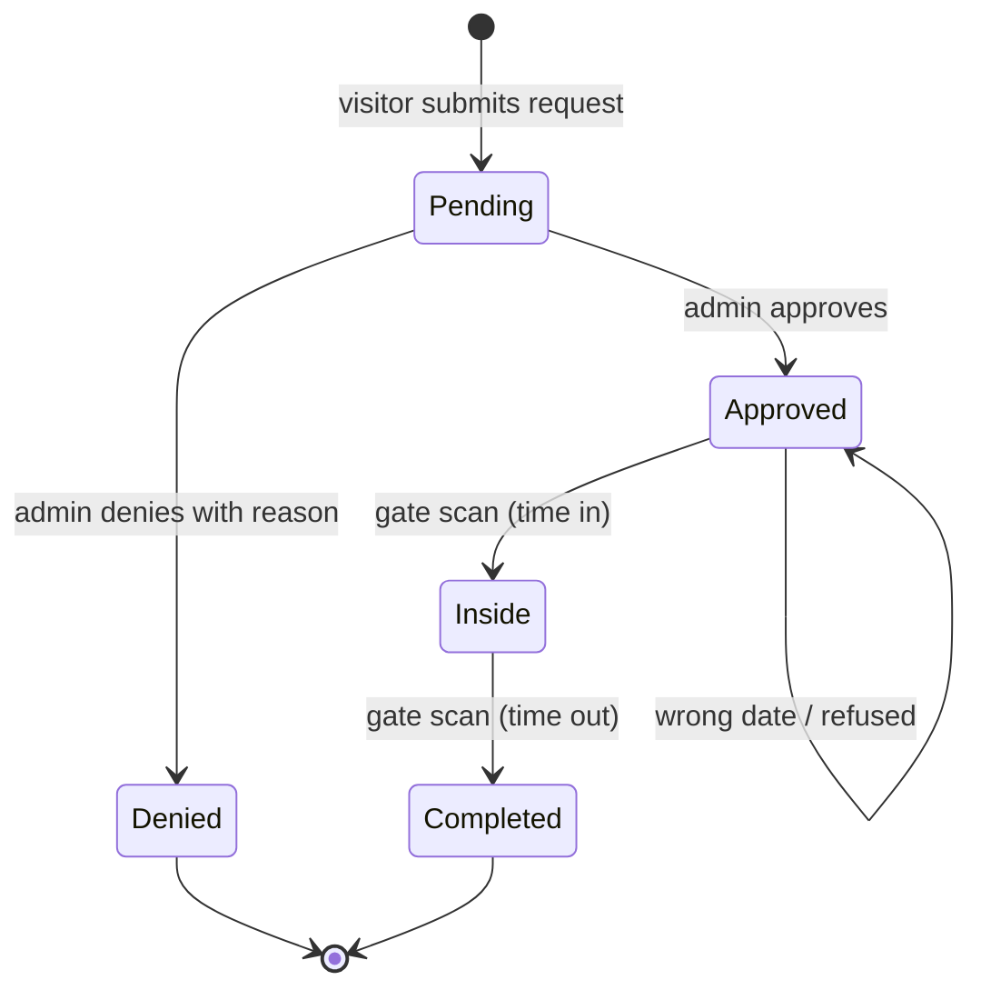
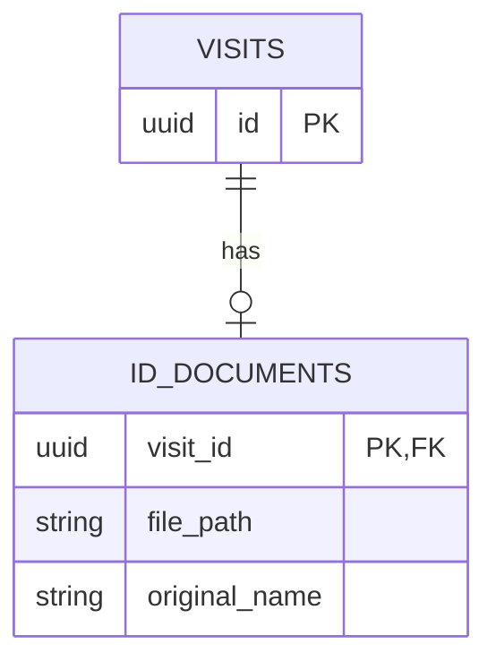

# QRVisits — Entity Relationship Diagram (ERD)

> **Interactive version:** open **`/context/erd`** in the running app for the
> rendered diagram, database structure tables and a print button.

Physical ERD for the application as built. Mermaid renders on GitHub and in
Markdown previews.

- **Core ERD** — users and visits.
- **Authentication tables** — sessions and passkeys (supporting, not part of
  visitor monitoring).
- **Data dictionary** and relationship matrix for the documentation chapter.

Legend: `PK` primary key, `FK` foreign key, `UK` unique. Crow's foot:

- `||` exactly one
- `|o` zero or one
- `o{` zero or many

---

## Core ERD

### How to read it

- A **user** may submit many visits; a visit belongs to zero or one user
  (`user_id` is empty for walk-ins).
- A visit may be **approved** by zero or one user, **checked in** by zero or one
  user, and **checked out** by zero or one user. These are separate audit
  references to the same `users` table.
- `pass_code` is unique across all visits and only filled in when a visit is
  approved. It is what the QR encodes.
- `id_document_path` + `id_document_name` are at most one uploaded ID per visit,
  stored as a file on the private disk.

---

## Authentication tables (supporting)

`PASSWORD_RESET_TOKENS` is keyed by email rather than a foreign key, which is
Laravel's standard design; it is not part of the visitor-monitoring domain.

The `visits` audit columns are not enforcing foreign-key cascades on purpose: if
a guard or admin account is removed, the historical visit record keeps its
visitor data while the audit reference becomes null (`nullOnDelete`).

---

## Relationship matrix

| Parent | Child | Relationship | Key | Optional |
| --- | --- | --- | --- | --- |
| users | visits | one-to-many | `visits.user_id` | Yes — walk-ins have no account |
| users | visits | one-to-many (approver) | `visits.approved_by` | Yes |
| users | visits | one-to-many (check-in guard) | `visits.checked_in_by` | Yes |
| users | visits | one-to-many (check-out guard) | `visits.checked_out_by` | Yes |
| users | sessions | one-to-many | `sessions.user_id` | Yes |
| users | passkeys | one-to-many | `passkeys.user_id` | Yes |
| visits | ID document | one-to-zero-or-one (embedded) | `visits.id_document_path` | Yes |

---

## Data dictionary — visits

| Column | Type | Rules | Meaning |
| --- | --- | --- | --- |
| `id` | UUID | primary key | Visit identifier |
| `user_id` | UUID | FK users, nullable, null on delete | Visitor account; empty for walk-ins |
| `visitor_name` | string | required | Name shown to guards and admins |
| `visitor_contact` | string(30) | required | Contact number from the request |
| `purpose` | string | required, max 255 | Reason for the visit |
| `host_name` | string | required, max 255 | Person or office being visited |
| `visit_date` | date | required, today or later at submission | Day the pass is valid |
| `expected_arrival` | time | nullable | Legacy field; no longer collected on new requests |
| `expected_time_out` | time | nullable | Expected leaving time; used to flag overdue visitors |
| `status` | string | pending / approved / denied / inside / completed | Current stage of the visit |
| `pass_code` | string(12) | unique, nullable | Short code encoded in the QR pass |
| `denial_reason` | text | nullable | Reason shown to the visitor when denied |
| `is_walk_in` | boolean | default false | Registered at the gate by a guard |
| `id_document_path` | string | nullable | Private-disk path of the uploaded ID |
| `id_document_name` | string | nullable | Original filename for display |
| `approved_at` | timestamp | nullable | When the admin decided |
| `approved_by` | UUID | FK users, nullable | Admin who approved or denied |
| `time_in` | timestamp | nullable | First successful gate scan |
| `time_out` | timestamp | nullable | Second successful gate scan |
| `checked_in_by` | UUID | FK users, nullable | Guard who scanned the visitor in |
| `checked_out_by` | UUID | FK users, nullable | Guard who scanned the visitor out |
| `created_at` / `updated_at` | timestamps | — | Audit timestamps |

### Status lifecycle

---

## Note on normalisation

The physical schema keeps the ID document inside `visits` because there is at
most one per visit. If your panel requires a separate entity, present it as a
1:1 relationship without changing the running system:

Framework infrastructure tables (`cache`, `cache_locks`, `jobs`,
`job_batches`, `failed_jobs`, `telescope_entries*`) are outside the business
domain and are normally omitted from the capstone ERD.
